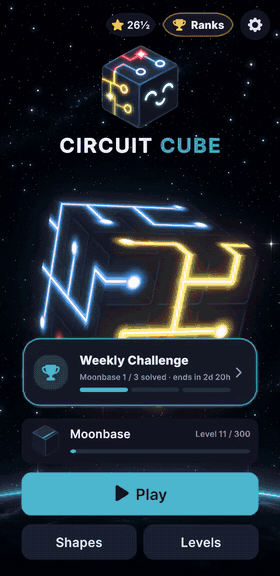

# Circuit Cube

A 3D circuit puzzle for mobile: rotate the tiles on a cube (and other shapes) so every lamp is lit by a source of the right colour.

- **Engine:** Unity 6000.0.76f1 (URP), Android first.
- **Version:** 1.4.0 (version code 7)

## Demo

  

Gameplay of 1.4.0 (7), shown at 1.5x speed: home screen, two cube levels solved, the leaderboard and the light theme.
Click it for the full 97 s video ([`docs/demo/circuitcube-1.4.0-demo.mp4`](docs/demo/circuitcube-1.4.0-demo.mp4)).

## What is in 1.4.0

- **Six shapes:** cube (Moonbase), tetrahedron (Pyramid), octahedron (Star Gem), sphere (Planet), dodecahedron
  (Galaxy) and megamix (Nebula). The build ships the first 100 cube levels; everything else downloads as content.
- **Weekly Challenge:** every Thursday three new levels per shape. No hints, no undo; fewest moves wins, then time.
- **Leaderboards** on Unity Gaming Services: a weekly board per shape (and per challenge level) and a lifetime board
  per shape (Expert levels, then moves, then time). The server replays every win before it posts a score
  (`Tools/CloudCode`, rules in `docs/leaderboards/logic.md`).
- **Expert and stars** judged by wasted moves past the fewest taps (`rules.wasteAllowed`, default 3), with a play
  clock that stops while Lumi talks.
- **Tutorial with Lumi** for new players, a lamp tray that shows each colour's progress, zoom on the shape.
- **New levels without an update:** levels are generated every month by AI, released weekly and follow player clear
  rates (see "Levels and config without a new build").
- English and Vietnamese, dark and light themes, crash reports, cloud save, in-app review and update prompts.

## Layout

| Path | What |
| --- | --- |
| `Assets/CircuitCube/Scripts` | Game code (`Core` = puzzle logic, `Game` = board, data, save, theme, `UI`) |
| `Assets/CircuitCube/Editor` | Editor setup tools (`Tools/Circuit Cube/...` menus) |
| `Assets/CircuitCube/Resources/CircuitCubeData` | Level data v3 (manifest, groups, levels, shapes) |
| `Assets/CircuitCube/Art` | Art: `Board/{Dark,Light,Shared}`, `UI/{Common,Icons,Shapes,Brand,Mascot,Backgrounds}`, `Fonts`, `Atlases`, `Materials/Board` (layout in `Editor/ArtPaths.cs`) |
| `Assets/CircuitCube/Themes` | `Theme_Dark` / `Theme_Light` assets |
| `Assets/CircuitCube/Tests` | Edit-mode tests |
| `Tools/LevelLab/index.html` | Level Lab (published as a claude.ai artifact): game rules, groups, the auto-level settings (shapes, levels per month, difficulty curve), queue status and **Publish to game**. It also holds the level generator the monthly task runs headless |
| `Tools/LevelLab/poly.js`, `publish.py` | The polygon shapes Level Lab shares with the game, and the script that turns its database into `content/` |
| `content/` | Levels and config as the game downloads them (written only by the publish task) |
| `ArtRef` | Art references, mockup and the sprite cutting scripts (`tools/cut_v2.py`) |
| `Tools/CloudCode` | Cloud Code module `CircuitCubeRanks` (replays wins, posts scores), leaderboard definitions and `deploy.ps1` |
| `StoreListing` | Play Store text, release notes, icon, feature graphic and screenshots |
| `docs/console-setup` | Play Console, Unity Dashboard (UGS) and Firebase setup |
| `docs/leaderboards`, `docs/demo` | Leaderboard rules; the demo video |
| `studio` | Studio kit reused by new games: skills, workflow rules, templates |

See `Assets/CircuitCube/README.md` for the data format and editor menus.

## Levels and config without a new build

Levels are made by AI only; nobody draws or edits them by hand.

1. Settings live in Level Lab (claude.ai artifact `WUkC8DCM543afEtakLwwx3`): **Rules & groups** (wasted moves for
   Expert, hints, undos, points, ads, forced update, group names, unlock order) and **Auto levels** (each group's
   shapes and sizes, levels per month, start difficulty, rise per month, cap, hard-level spacing, target clear rate,
   top-up). Saving rules or groups publishes by itself; a failed or stalled publish is retried once.
2. On day 1 of each month the scheduled task "Circuit Cube: monthly level batch" generates each group's levels and
   weekly challenge sets with Level Lab's own generator (scripts in the Level Lab database, collection `autofill`),
   checks and bot-plays every one, and queues them. Every Thursday "Circuit Cube: weekly level release" releases a
   share of the queue, opens the week's challenge and starts the publish task.
   With player data (Firebase Analytics exported to BigQuery, read with the service account key in the cloud
   environment variable `GCP_SA_KEY`), both runs follow the players: `stats.js` turns the export into clear rates per
   group; the monthly batch moves a group's difficulty towards the target clear rate (70-85 % by default), the weekly
   run releases twice as many levels and tops up the queue when many players are at a group's last levels, and the
   monthly run writes a Vietnamese report (Level Lab, Auto levels). Without the key, the fixed curve is used.
3. Publishing ("Circuit Cube: publish Level Lab levels", or the **Publish to game** button for a rules change) checks
   every level (`Tools/LevelLab/publish.py`), commits `content/` to main, then pins that commit in
   `content/manifest.json` (`cdn` = the commit on jsDelivr), then waits until the manifest players read shows the
   new version and records how long that took. The status line in Level Lab shows the result.
4. Players get it without an update: the game reads `content/manifest.json` from GitHub
   (`CircuitCubeApp.ContentBaseUrl`) at start (the splash waits up to 3.5 s for it), every 3 minutes and when it
   comes back to the front, then downloads new or edited levels around their position from the pinned commit. A
   player in a level finishes it first and then sees a "New levels are here" card.

A new build is needed only for new code: a new kind of shape, a new screen or rule the game does not know yet.
Unity is only needed to ship a new build: run Tools > Circuit Cube > Data > Copy Published Content into the Build so
the build carries the latest publish for offline players.

## Services (1.4.0)

Each one is built only when its package is in `Packages/manifest.json` (version defines in `CircuitCube.asmdef`);
without it the game runs as before.

| Service | Package | Code | Set up outside Unity |
| --- | --- | --- | --- |
| Crash reports | `com.google.firebase.crashlytics` (CC_CRASHLYTICS) | `Game/Services/CrashReports.cs` | Firebase console > Crashlytics: enable |
| Rating card | `com.google.play.review` (CC_REVIEW) | `Game/Services/AppReview.cs` | none (works from a Play install) |
| Cloud save | `com.google.play.games` (CC_PLAYGAMES) | `Game/Services/CloudSave.cs`, `CubeSave.Cloud.cs` | Play Console > Play Games Services: create, add the Android credential (SHA-1 of the app signing key), Saved Games on; paste the resources into Window > Google Play Games > Setup > Android setup |
| Leaderboards | `com.unity.services.authentication`, `.leaderboards`, `.cloudcode` (CC_UGS) | `Game/Services/Ranks.cs`, `CircuitCubeApp.Ranks.cs` | Unity Cloud Dashboard: link the project, turn on Authentication, Leaderboards, Cloud Code; deploy with `Tools/CloudCode/deploy.ps1` (see `Tools/CloudCode/README.md`) |
| Vietnamese | built in | `Game/Loc.cs`, `Game/LocVi.cs`, `UI/LocText.cs` | none |

## Getting started

1. Open the folder with Unity Hub (Unity 6000.0.76f1).
2. Open `Assets/CircuitCube/Scenes/CircuitCube.unity` and press Play.
3. Debug keys: F1 debug menu, F2 toggle dark/light theme.
